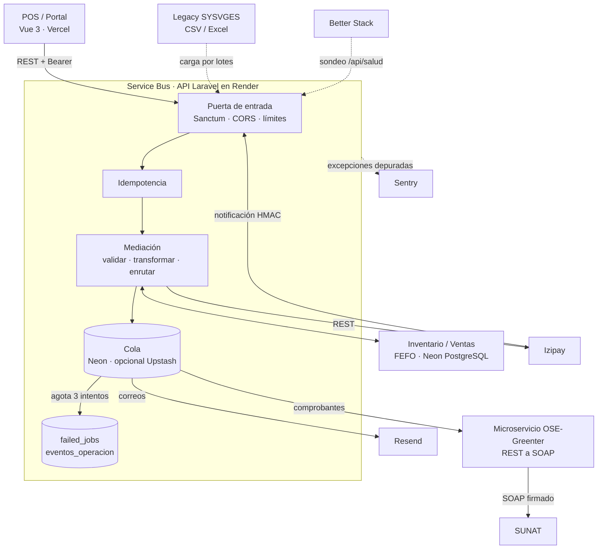

# Integración mediante un Service Bus (ESB) · Botica San Juan

> Actividad práctica de Arquitectura Orientada al Servicio. Corte: v0.9.0.
>
> **Qué es real y qué es diseño.** No hay un producto ESB desplegado (Mule, WSO2,
> Camel). La API de Laravel cumple hoy parte de sus funciones. Cada apartado
> distingue lo **implementado** de lo **propuesto**.

## 1. Sistemas que se integran

Cinco sistemas activos y uno heredado:

| # | Sistema | Papel | Interfaz | Estado |
|---|---|---|---|---|
| 1 | **POS / Portal** | Venta en mostrador, catálogo y checkout (Vue 3) | REST + JSON, Bearer de Sanctum | Implementado |
| 2 | **Inventario / Ventas** | Lotes FEFO, pedidos, caja (Laravel + PostgreSQL) | Servicios internos y REST | Implementado |
| 3 | **SUNAT / OSE** | Comprobantes electrónicos | REST hacia el microservicio OSE-Greenter; SOAP detrás de él | Cliente implementado; `simulado` por omisión, sin microservicio desplegado |
| 4 | **Izipay** | Cobro con tarjeta | REST y notificación firmada (HMAC-SHA-256) | Implementado; `simulado` por omisión |
| 5 | **Resend** | Correo transaccional | REST | Implementado y probado en producción |
| — | **Legacy SYSVGES** | Sistema de escritorio anterior: origen del catálogo histórico | Archivos CSV / Excel | Carga por lotes; sin enlace en línea |

## 2. Problemas de la integración punto a punto

Con *n* sistemas conectados todos con todos hay hasta *n(n−1)/2* enlaces: con
seis, **15**. Con un bus, **6** conectores.

| Problema | Cómo se manifiesta aquí |
|---|---|
| Acoplamiento al proveedor | Cambiar de pasarela obligaría a tocar el checkout, el POS y la anulación |
| Formatos distintos | JSON propio, SOAP y CDR de SUNAT, firma de Izipay, CSV del sistema heredado |
| Fallos en cascada | Un Resend lento alargaba el registro y la compra, aunque ya estuvieran guardados |
| Reintentos duplicados | Reenviar un cobro o un comprobante puede duplicarlo |
| Seguridad dispersa | Cada enlace custodia sus credenciales |
| Sin trazabilidad | Un pedido fallido exige revisar el registro de cada extremo |

## 3. Funciones del Service Bus

| Función | Implementado en v0.9.0 | Propuesto |
|---|---|---|
| **Enrutamiento** | `SunatClient` elige destino por modo (`simulado`, `beta`, `produccion`, `api`) | Enrutamiento por contenido (boleta, factura, nota) |
| **Transformación** | `EmpaquetadoSunat`, `ConstanciaRecepcion`, importador CSV/Excel | Modelo canónico de venta común a todos los conectores |
| **Mediación de protocolo** | REST ↔ SOAP en el microservicio OSE-Greenter (contrato definido) | Desplegar ese microservicio |
| **Mensajería asíncrona** | Cola `correos` sobre PostgreSQL; trabajo `EnviarComprobanteASunat` | Upstash Redis cuando el volumen lo pida |
| **Orquestación** | `PedidoService`: stock, comprobante y correo en orden | Saga con compensación (no existe anulación de venta) |
| **Idempotencia** | Middleware `Idempotencia`; trabajo único por comprobante; `uuid_local` en ventas offline | — |
| **Reintentos** | Tres intentos con espera creciente y `failed_jobs` | Panel para reprocesar la cola de fallidos |
| **Contrato** | OpenAPI 0.9.0 en `/docs/v1` y `/docs/api` | Registro de servicios con versiones |

## 4. Componentes

1. **Conectores (adaptadores).** Uno por sistema: `IzipayClient`, que cumple el
   contrato `PasarelaPago`; `SunatClient`; el transporte de Resend; el importador.
2. **Canal de mensajes.** Tabla `jobs` de Neon. El mensaje lleva identificadores,
   nunca datos personales ni tokens.
3. **Motor de mediación.** Servicios de aplicación que validan, transforman y
   enrutan.
4. **Registro de contratos.** Documento OpenAPI generado del código y
   `mapa-servicios.json`.
5. **Almacén de errores.** `failed_jobs` y `eventos_operacion`.
6. **Consola.** `/admin/eventos`, Sentry y Better Stack.

## 5. Diagrama

## 6. Seguridad

- **Autenticación:** Sanctum para personas, token Bearer hacia el OSE, usuario y
  contraseña hacia Izipay.
- **Integridad:** la notificación de Izipay se acepta solo con firma HMAC válida.
- **Separación de entornos:** `SunatClient` rechaza un modo desconocido, una URL
  de `sunat.gob.pe`, HTTP remoto y `produccion` fuera de `APP_ENV=production`.
- **Datos mínimos en la cola:** la recuperación de contraseña encola un
  identificador; el token se genera al ejecutar y no queda en `jobs`.
- **Errores sin datos personales:** la excepción del proveedor se sustituye antes
  de llegar a `failed_jobs`, porque suele contener la dirección del destinatario.
- **Secretos:** solo en variables de entorno; los `.env.example` van vacíos.

## 7. Monitoreo

| Herramienta | Qué vigila | Estado |
|---|---|---|
| **Sentry** | Excepciones de API y portal, depuradas | Integrado; activo solo con DSN |
| **Better Stack** | Sondeo externo de `/api/salud` | Endpoint listo; el monitor se crea en su panel |
| **Cola** | `/api/salud` informa `cola: false` si un correo lleva más de 10 min | Implementado |
| **Bitácora** | `CORREO_ENVIADO`, `CORREO_FALLIDO`, `SUNAT_*` | Implementado |
| **Resend** | Registro de llamadas `POST /emails` | [Captura](../evidencias/informe-final/21-resend-api-logs-200.png) |
| **Laravel Pulse** | Consultas lentas y trabajos | Documentado, no instalado |

La configuración está en [OBSERVABILIDAD.md](../OBSERVABILIDAD.md), sección 7.

## 8. Flujo de ejemplo: compra en el portal

1. El portal envía `POST /pedidos/confirmar` con clave de idempotencia.
2. El bus valida y descuenta los lotes por FEFO en una transacción.
3. Emite el comprobante interno y responde `201`.
4. Encola la confirmación, que se envía **después** de la respuesta.
5. Si Resend falla, el planificador lo reintenta; a la tercera pasa a
   `failed_jobs` y queda `CORREO_FALLIDO` en la bitácora.

La venta no depende de Resend: ese desacoplamiento es el beneficio central del
bus.

## 9. Límites

- Sin worker dedicado, si Render duerme el servicio la cola espera a que despierte.
- El planificador solo atiende la cola `correos`. El envío asíncrono a SUNAT
  (`default`) necesita un worker propio antes de activarse.
- El bus comparte proceso con la API: no escala por separado.
