# Informe Final · Sección V: Operación del Sistema (S18)

**Proyecto:** Botica San Juan · Sistema Web de Gestión Farmacéutica, POS Offline y Portal Cliente  
**Estado del proyecto:** Finalizado en **v0.8.0**  
**Alcance de este documento:** Puntos **28 al 34** del Informe Final (Sección V · Operación del Sistema). El entregable previo **APF3** (`docs/INFORME-APF3.md` y su `.docx`) permanece intacto como registro histórico.

---

## 28. Correcciones al APF3

La **Tabla 64** de `docs/INFORME-APF3.md` dejó cuatro observaciones abiertas (`O-B1` a `O-B4`). A continuación se detalla la corrección aplicada y su estado al cierre en **v0.8.0**:

| N.º | Observación original (Tabla 64 del APF3) | Corrección aplicada | Estado actual | Evidencia |
|---|---|---|---|---|
| **O-B1** | Las Figuras 43 y C.3 muestran ejecuciones de la suite con 98/246 y 139/421, cifras ya superadas. | Se re-ejecutaron las suites completas sobre PostgreSQL 16 y Vitest para reflejar el corte final (**500** pruebas de backend, **209** de frontend, **709** en total). | **Cerrada** (actualizada al corte v0.8.0) | `docs/evidencias/cortes/CRT-35-suite-440.png`, `CRT-37-suite-frontend-196.png`, informe v0.5.0 y corte final **709** |
| **O-B2** | La Figura 11 rotula «26 migraciones versionadas» dentro del PNG; en APF3 eran 46/49. | Se creó `docs/scripts/generar-figura11.py` para contar dinámicamente los archivos de migración y regenerar el diagrama sin cifras fijas. | **Cerrada** | `docs/evidencias/figura11/LEEME.md` (54 migraciones al momento del script; **61** al cierre) |
| **O-B3** | Las cifras del portal público («más de 10 años», «8k clientes») no coinciden entre Inicio, Sobre Nosotros y el pie. | Se homologó el texto por decisión de negocio en las cuatro vistas públicas («+800 productos farmacéuticos», «Más de 8 años de servicio en San Juan de Lurigancho», «Atención directa en nuestro local principal y delivery local»). | **Cerrada** | `Hero.vue`, `Stats.vue`, `AboutContent.vue`, `Footer.vue` |
| **O-B4** | Los 884 productos del catálogo apuntan a `images/default_image.png`, archivo que respondía 404. | Se verificó el archivo servido en producción y se ejecutaron pasadas de extracción/emparejamiento de fotografías reales. | **Cerrada** | `docs/evidencias/produccion/INFORME-QA-PROD.md` (`200`, `image/png`, 2 255 B, 512×512; **194** productos con foto real en producción) |

> **Nota sobre trazabilidad:** No quedan observaciones de la Tabla 64 del APF3 abiertas por falta de ejecución; las limitaciones operativas vigentes (infraestructura gratuita, respaldo diario sin programar, verificación de dominio en Resend) se declaran explícitamente en las secciones **29**, **32**, **33** y **34**.

---

## 29. Monitoreo del sistema: indicadores, umbrales y mecanismos

Siguiendo `docs/MONITOREO-Y-UMBRALES.md`, los compromisos de las **Tablas 33 y 34 del APF1** se tradujeron en reglas ejecutables con seis elementos (`canal`, `agregación`, `métrica`, `comparador`, `valor`, `ventana`) y doble umbral (**preventivo** y **crítico**).

### 29.1. Arquitectura de monitoreo activo y pasivo

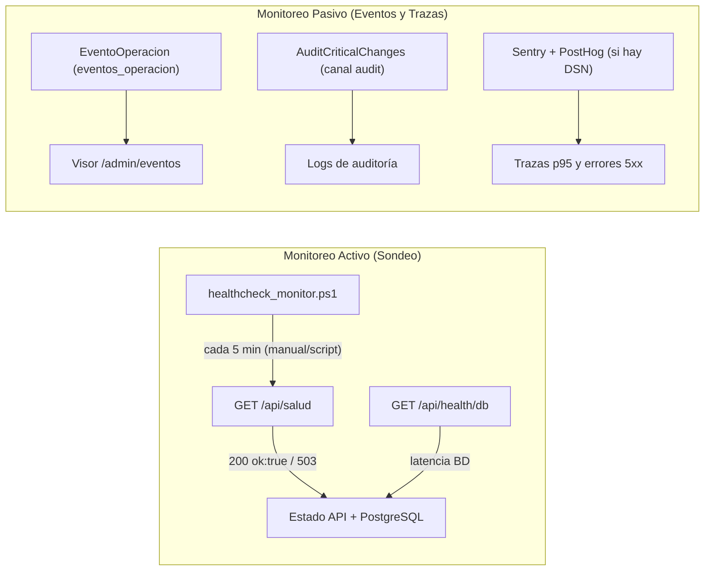

- **Monitoreo activo (`botica-san-juan-backend/routes/api.php`):** `GET /api/salud` (público, protegido con `throttle:api`) verifica la conexión PDO a PostgreSQL y responde `200` con `{"ok": true, "base": true, "hora": "..."}` o `503` si falla la base. Se complementa con `GET /api/health/db` y `infra/monitoring/healthcheck_monitor.ps1`.
- **Monitoreo pasivo:** Bitácora persistente en `eventos_operacion` consultable en `/admin/eventos`, middleware `AuditCriticalChanges` (`app/Http/Middleware/AuditCriticalChanges.php`) para mutaciones críticas, y trazas/errores en Sentry y PostHog cuando existen claves configuradas (`docs/OBSERVABILIDAD.md`).

### 29.2. Matriz de indicadores y umbrales

| # | Indicador | Cómo se mide | Preventivo | Crítico | Acción operativa | Estado real (v0.8.0) |
|---|---|---|---|---|---|---|
| **M1** | Disponibilidad del servicio | Sondeo `GET /api/salud` y `GET /api/health/db` cada 5 min (`200` con `ok:true`), franja 08:00–22:00 | < 99,5 % en 7 días | 2 sondeos seguidos fallidos (10 min) o < 99 % mensual | Revisar Render y Neon; abrir incidente P1 | **Script existente, sin programar** (ver 29.4) |
| **M2** | Latencia de la API (p95) | Percentil 95 de rutas de lectura, ventana 15 min (Sentry) | p95 > 800 ms (15 min) | p95 > 1 500 ms (15 min) | Identificar ruta por traza y revisar índices | **Instrumentado sin umbral configurado** |
| **M3** | Latencia de búsqueda | p95 de `/api/productos?buscar=` y `/api/catalogo?buscar=` bajo carga | p95 > 1 000 ms | p95 > 2 000 ms | Detener promesa de «< 2 s» hasta optimizar | **Sin medir** (prueba de carga pendiente) |
| **M4** | Tasa de error servidor (5xx) | `5xx ÷ total`, ventana 15 min (Sentry / Render) | > 0,5 % en 15 min | > 1 % en 15 min o **cualquier 5xx en catálogo público** | Incidente P2 mínimo | **Instrumentado sin umbral configurado** |
| **M5** | Errores cliente por versión | Eventos Sentry en frontend por *release*, primeras 24 h | > 5 eventos nuevos | Error afecta > 1 % de sesiones | Revertir despliegue en Vercel | **Activo** (cuando hay `VITE_SENTRY_DSN`) |
| **M6** | Coherencia del despliegue | Tras publicar: `/api/catalogo` → 200, `/docs/v1` → 200, `/api/productos/destacados` → 404 | Respuesta distinta a la esperada | Ídem + `update_failed` en Render | Re-desplegar; no dar por bueno el *release* | **Manual** (originado tras INC-01) |
| **M7** | Memoria del proceso | Métrica instancia Render, media 15 min | > 70 % límite plan | > 90 % (15 min) o OOM | Perfilar petición causante | **Sin medir** |
| **M8** | Consultas SQL por petición | Presupuesto en rutas de listado | > 15 consultas | > 40 consultas o patrón N+1 | Aplicar carga anticipada (`with()`) | **Sin medir** |
| **M9** | Éxito del respaldo diario | Código de salida del respaldo; simulacro mensual | 1 fallo en 7 días | 2 fallos seguidos o simulacro fallido | Respaldo manual inmediato | **Parcial** (simulacro OK; cron diario inactivo) |
| **M10** | Comprobantes SUNAT | Aceptados ÷ enviados según CDR diario | < 99 % | < 97 % o 3 rechazos mismo código | Pausar envío automático y revisar XML | **Medible sin volumen real** |
| **M11** | Pruebas automatizadas | Resultado del pipeline CI por subida | Cualquier prueba en rojo | Rojo en `main` | Bloquear despliegue | **Activo** |
| **M12** | Eventos `error` en bitácora | Conteo en `eventos_operacion` (`nivel = error`), ventana 24 h | > 10 en 24 h | > 50 en 24 h o 5 del mismo código en 1 h | Abrir incidente por fallo sistemático | **Activo y consultable** en `/admin/eventos` |

### 29.3. Segmentación de umbrales

| Segmento | Alcance | Ajuste sobre umbral base (M2, M4, M7, M8) |
|---|---|---|
| **Mostrador (POS)** | Venta, cobro y búsqueda en caja | **La mitad** (impacto directo en cliente presencial) |
| **Catálogo público** | `GET /api/catalogo*`, documentación OpenAPI | **Base** (consumo externo / terceros) |
| **Panel administración** | Tablero, inventario, reportes | **El doble** (uso interno no bloqueante en caja) |
| **Procesos de fondo** | Envío SUNAT, sincronización offline, importación DIGEMID | Sin umbral de latencia; control por tasa de error y cola |

### 29.4. Impedimento del 99 % de disponibilidad

En la capa gratuita de Render la instancia se suspende tras **15 minutos sin tráfico**, con ~50 s de arranque en frío. Un sondeo cada 5 minutos mantendría artificialmente despierta la instancia, fabricando disponibilidad en lugar de medirla. Por ello, el compromiso del **99 % (RNF05)** se declara **no verificable en la infraestructura actual** y sujeto a migración a un plan de pago.

### 29.5. Estados de alerta y recuperación

| Estado | Condición | Ejemplo con `/api/salud` (M1) | Ejemplo con la bitácora (M12) | Respuesta |
|---|---|---|---|---|
| **INFO** | Dentro del umbral | `200` con `ok:true` | Eventos `info`, como `CORREO_ENVIADO` | Se registra, sin acción |
| **WARNING** | Cruza el preventivo | < 99,5 % en 7 días | > 10 errores en 24 h | Revisar el mismo día |
| **ERROR** | Cruza el crítico | 2 sondeos seguidos fallidos (10 min) | > 50 en 24 h o 5 del mismo código en 1 h | Abrir incidente y priorizar |
| **RECOVERY** | Vuelve al rango | Sondeo en `200` verificado | Sin eventos nuevos del código afectado | Verificar, cerrar y anotar la causa |

> **Nota:** `RECOVERY` es un estado del procedimiento, no un nivel de `EventoOperacion`: la bitácora guarda `info`, `warning` y `error`. El sondeo automático no está programado, así que hoy la transición la comprueba una persona.

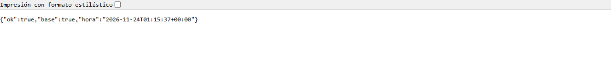

---

## 30. Gestión de eventos de operación (`EventoOperacion`)

La gestión de eventos se apoya en el modelo `App\Models\EventoOperacion` (`botica-san-juan-backend/app/Models/EventoOperacion.php`), su tabla `eventos_operacion`, el espejo local en caja (`src/offline/bitacora.ts`) y el visor administrativo `/admin/eventos` (`GET /api/eventos` y `GET /api/eventos/resumen`, protegidos por middleware `admin`, con enmascaramiento de datos sensibles mediante `Depurador::texto`).

### 30.1. Niveles y mapeo de `CRITICAL`

`EventoOperacion` define exactamente **tres niveles** mediante constantes estáticas:
- `NIVEL_INFO = 'info'` (`EventoOperacion::info(...)`)
- `NIVEL_AVISO = 'warning'` (`EventoOperacion::advertencia(...)`)
- `NIVEL_ERROR = 'error'` (`EventoOperacion::error(...)`)

**El nivel `critical` no existe en `EventoOperacion`.** En la arquitectura del sistema, los eventos de severidad crítica se mapean de dos formas complementarias:
1. Se registran en `eventos_operacion` con nivel **`error` (`NIVEL_ERROR`)**, distinguiéndose por su **`codigo` estable** de alto impacto (por ejemplo `PAGO_RECIBIDO_PEDIDO_ANULADO`, `SUNAT_ENVIO_FALLIDO` o `CORREO_TRANSPORTE_INVALIDO`).
2. La criticidad operativa se evalúa en los **umbrales de monitoreo** (indicador **M12**: `> 50` eventos `error` en 24 h o `5` eventos del mismo código en 1 h escalan a incidente), complementados por el canal `audit` (`AuditCriticalChanges`) y Sentry para excepciones no controladas.

### 30.2. Ejemplos reales de códigos registrados en el código fuente

| Nivel en `EventoOperacion` | Código estable | Origen / Archivo | Situación que registra |
|---|---|---|---|
| `info` | `SYNC_VENTA_CREADA` | `SincronizacionVentasService.php` | Venta offline registrada en servidor con pedido y correlativo oficial. |
| `info` | `SYNC_LOTE_PROCESADO` | `SincronizacionVentasService.php` | Resumen de lote sincronizado desde caja (creadas, duplicadas, rechazadas). |
| `info` | `IMPORTACION_INVENTARIO` | `ImportadorInventarioService.php` | Confirmación de carga masiva de inventario (filas, productos, lotes, unidades). |
| `info` | `PEDIDO_CANCELADO` | `PedidoService.php` | Cancelación de pedido con restitución de stock por lote. |
| `info` | `PERFIL_CONTRASENA_CAMBIADA` | `PerfilController.php` | Cambio de contraseña y revocación de otras sesiones (`PERFIL_FOTO_ACTUALIZADA`, `PERFIL_GOOGLE_DESVINCULADO`). |
| `info` | `SUNAT_CDR_RECIBIDO` | `FacturadorSunat.php` | Constancia CDR recibida y guardada con código y estado. |
| `info` | `CORREO_ENVIADO` | Flujo de correo transaccional | Envío exitoso de correo transaccional (verificación, recuperación, bienvenida o compra registrada). |
| `warning` | `SYNC_VENTA_DUPLICADA` | `SincronizacionVentasService.php` | Reenvío idempotente de un `uuid_local` ya registrado; se ignora sin duplicar pedido. |
| `warning` | `SYNC_STOCK_INSUFICIENTE` | `SincronizacionVentasService.php` | Venta offline aceptada que generó incidencia de inventario por falta de stock. |
| `error` *(mapeo de crítico)* | `SYNC_VENTA_RECHAZADA` | `SincronizacionVentasService.php` | Venta offline rechazada por datos inválidos (ej. producto inexistente). |
| `error` *(mapeo de crítico)* | `PAGO_RECIBIDO_PEDIDO_ANULADO` | `PagoService.php` | Pago confirmado sobre un pedido ya anulado; requiere devolución manual. |
| `error` *(mapeo de crítico)* | `SUNAT_ENVIO_FALLIDO` | `FacturadorSunat.php` | Excepción de transporte/envío hacia SUNAT; comprobante queda en `pendiente`. |
| `error` *(mapeo de crítico)* | `CORREO_FALLIDO` | Flujo de correo transaccional | Fallo al despachar correo transaccional sin abortar la operación principal. |
| `error` *(mapeo de crítico)* | `CORREO_TRANSPORTE_INVALIDO` | Flujo de correo transaccional | Configuración o transporte de correo inválido detectado al intentar enviar. |

En producción, la prueba de correo del 23 de noviembre de 2026 dejó **4** eventos `CORREO_ENVIADO`; la bitácora mostraba **7** `info`, **0** `warning` y **0** `error` (`15-admin-eventos-resend-ok.png`).

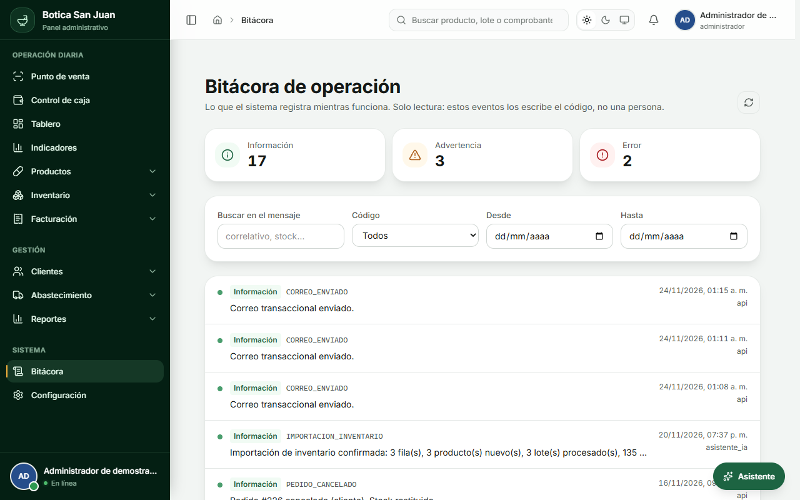

---

## 31. Gestión de incidentes (ITIL 4)

### 31.1. Flujo de atención de 10 etapas

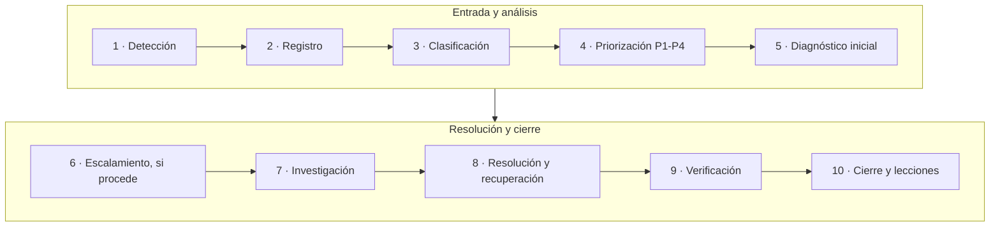

### 31.2. Matriz Impacto / Urgencia y prioridades P1–P4

| Impacto \ Urgencia | Alta (detiene operación o bloquea pago/venta) | Media (degrada función con alternativa) | Baja (cosmético o documentación) |
|---|---|---|---|
| **Alto** (afecta a todos los usuarios / flujo crítico) | **P1 · Crítica** (atención inmediata) | **P2 · Alta** (mismo día) | **P3 · Media** (siguiente iteración) |
| **Medio** (afecta a un flujo o subconjunto de usuarios) | **P2 · Alta** (mismo día) | **P3 · Media** (siguiente iteración) | **P4 · Baja** (planificada) |
| **Bajo** (sin bloqueo operativo) | **P3 · Media** (siguiente iteración) | **P4 · Baja** (planificada) | **P4 · Baja** (planificada) |

### 31.3. Fichas de incidentes reales registrados en el repositorio

Además de los incidentes previos **INC-01** (P1, fallo silencioso de `config:cache` por closure en `config/sentry.php`, PR #36) e **INC-02** (P2, `500` en `/api/productos/destacados`, PR #32) documentados en `docs/GESTION-DE-INCIDENTES.md`, durante el cierre hacia **v0.8.0** se atendieron y cerraron los siguientes tres incidentes:

#### Ficha A · Bloqueo CORS en checkout de pagos (P1)

| Campo | Detalle verificado |
|---|---|
| **Prioridad** | **P1** (bloqueo de pago con tarjeta en producción) |
| **Fecha de resolución** | 19 de noviembre de 2026 (commit `1fa1971`, PR **#62** merge `6de4532`) |
| **Tiempo de detección / atención** | No consta |
| **Síntoma** | El *preflight* CORS en producción rechazaba la cabecera `Idempotency-Key` y `axios` mostraba «Sin conexión con el servidor» al intentar pagar en `/cart`. Adicionalmente, sin credenciales de Izipay configuradas, el cliente recibía nombres internos de variables de entorno. |
| **Causa raíz** | `botica-san-juan-backend/config/cors.php` no declaraba `'Idempotency-Key'` en `allowed_headers` (en local no se manifestaba porque Vite actúa como proxy en el mismo origen). En `IzipayClient.php`, el mensaje de error exponía `IZIPAY_USERNAME` / `IZIPAY_PASSWORD`. |
| **Resolución y verificación** | Se añadió `'Idempotency-Key'` a `allowed_headers` en `config/cors.php`, se sustituyó el mensaje expuesto al cliente en `IzipayClient.php` registrando el detalle técnico con `Log::warning`, y se agregó la prueba `CorsPagosTest`. |
| **Estado** | **Cerrado** |

#### Ficha B · Redirección rota tras Google OAuth a `/perfil` (P2)

| Campo | Detalle verificado |
|---|---|
| **Prioridad** | **P2** (afecta flujo de alta/completado de DNI tras OAuth; existe acceso por otras rutas del portal) |
| **Fecha de resolución** | 19 de noviembre de 2026 (commit `28d251b`, PR **#61** merge `810a1f8`) |
| **Tiempo de detección / atención** | No consta |
| **Síntoma** | Al retornar de Google OAuth cuando `sesion.necesita_dni` era verdadero, el usuario era redirigido a `/perfil`, obteniendo un `404` tras la reorganización del portal cliente. |
| **Causa raíz** | `botica-san-juan-frontend/src/auth/GoogleCallbackView.vue` apuntaba a la ruta heredada `/perfil` en lugar de `/client/perfil`, y `src/router/index.ts` no contaba con alias de redirección para `/perfil`. |
| **Resolución y verificación** | Se corrigió la redirección en `GoogleCallbackView.vue` a `/client/perfil`, se añadió el alias `/perfil` → `/client/perfil` en `src/router/index.ts`, y se incorporó la aserción en `ClientLayout.spec.ts`. |
| **Estado** | **Cerrado** |

#### Ficha C · Errores y advertencias en generación OpenAPI / Scramble (P3)

| Campo | Detalle verificado |
|---|---|
| **Prioridad** | **P3** (defecto de documentación técnica y contrato OpenAPI; no detiene operación comercial) |
| **Fecha de resolución** | 20 de noviembre de 2026 (commit `81f489f`, PR **#63** merge `b3f391b` y PR **#64** merge `23b9bfc`) |
| **Tiempo de detección / atención** | No consta |
| **Síntoma** | Scramble reportaba errores/advertencias (`VR002`/`VR003`) al analizar rutas de validación dinámica y la especificación publicada mostraba versión `0.5.0` en lugar de `0.8.0`. |
| **Causa raíz** | Reglas de validación dependientes del estado de sesión o tipo de comprobante en `PedidoController.php` y referencias a constantes privadas/dinámicas en `EventoOperacionController.php`, `PerfilController.php` y `RecetaController.php`, además de `API_VERSION` en `0.5.0` en `config/scramble.php` y `.env.example`. |
| **Resolución y verificación** | En `PedidoController.php` se mantuvo la validación real con `Validator::make(...)` y se añadió el subconjunto literal documentable para Scramble sin cambiar el comportamiento; se ajustaron literales/visibilidad en los controladores afectados y se actualizó la versión a `0.8.0`. |
| **Estado** | **Cerrado** |

---

## 32. Continuidad operativa, respaldos y contingencia offline

### 32.1. Respaldos y simulacro de recuperación

- **Política y SLA internos (`docs/CONTINUIDAD_OPERATIVA.md`):** Detección `< 5 min`, contención Sev-1 `< 15 min`, restauración Sev-1 `< 60 min`, **RPO objetivo ≤ 24 h**, **RTO objetivo ≤ 60 min (3 600 s)**.
- **Simulacro ejecutado (`infra/backup/run_restore_drill_postgres.ps1`):** Frente al script inicial sobre SQLite (`run_restore_drill.ps1`, que restauraba sobre sí mismo), se implementó y ejecutó un simulacro destructivo sobre **PostgreSQL 16.15** (`botica_san_juan` → `botica_staging`), borrando deliberadamente 5 filas del padrón DIGEMID (tabla hoja elegida tras comprobar que las llaves foráneas `RESTRICT` impiden borrar productos con ventas en `pedido_detalle_lotes`).

| Métrica del simulacro PostgreSQL (`CON-01`, `CON-03`) | Resultado medido |
|---|---|
| Tamaño del respaldo | 0,16 MB |
| Tiempo de respaldo / restauración inicial | 0,19 s / 0,73 s |
| Recuperación tras daño simulado (5 → 0 → 5 filas DIGEMID) | **0,74 s** (5 de 5 recuperadas; 884 productos, 50 pedidos y 9 usuarios intactos) |
| **RTO medido vs. comprometido** | **0,93 s** vs. 3 600 s (60 min) — **Cumple** (condicionado al tamaño de 0,16 MB en entorno local) |
| **RPO de 24 horas** | **Pendiente de automatización** (los scripts existen, pero la tarea programada diaria no está activa) |

### 32.2. Contingencia POS Offline (`docs/ARQUITECTURA-OFFLINE.md`)

- **Persistencia local:** Capa abstracta (`src/offline/`) con driver IndexedDB en navegador (y diseño preparado para SQLite en Tauri) más cola y bitácora local (`src/offline/bitacora.ts`).
- **Idempotencia:** Cada venta sin conexión genera un **UUID v4** (`pedidos.uuid_local` con índice `UNIQUE`) y una nota de contingencia interna (`NV-*`, que no sustituye al comprobante SUNAT).
- **Sincronización:** `POST /api/v1/ventas/sincronizar` procesa lotes de hasta **50 ventas**, cada una en su propia transacción (`creada`, `duplicada` tratada como éxito, o `rechazada` sin arrastrar al lote). Umbrales de atraso en cola: **24 h** (`warning`) y **48 h** (`error`).
- **Pendiente operativo detectado en ensayo:** La búsqueda en caja sigue consultando la API si no se conecta al catálogo maestro descargado localmente (`docs/ARQUITECTURA-OFFLINE.md`, sección 11).

### 32.3. Límite del disco efímero de Render

`storage:link` permite servir archivos subidos (fotos de perfil y recetas en almacenamiento local), pero **el disco del plan gratuito de Render es efímero**: los archivos subidos al sistema de archivos local **no sobreviven a un redespliegue**. La solución definida es migrar el almacenamiento de archivos adjuntos a almacenamiento de objetos externo (S3 o Cloudflare R2).

Evidencia del simulacro: `docs/evidencias/continuidad/` (`CON-01`, `CON-03`).

### 32.4. BCM, ITSCM y DR

| Disciplina | Pregunta que responde | En Botica San Juan |
|---|---|---|
| **BCM** (continuidad del negocio) | ¿Cómo sigue atendiendo la botica? | Venta en mostrador con el POS offline y nota interna de contingencia |
| **ITSCM** (continuidad del servicio de TI) | ¿Cómo se sostienen los servicios que el negocio necesita? | Monitoreo, respaldos, umbrales, roles y simulacro de restauración |
| **DR** (recuperación ante desastres) | ¿Cómo se restaura lo que cayó? | Restauración de PostgreSQL, redespliegue de API y portal, verificación |

### 32.5. Análisis de impacto (BIA)

Los límites globales comprometidos son **RTO ≤ 60 min** y **RPO ≤ 24 h** (`docs/CONTINUIDAD_OPERATIVA.md`). El reparto por servicio es el **objetivo propuesto** en este informe; no es una medición.

| Servicio crítico | Impacto si cae | Prioridad | RTO objetivo | RPO objetivo | Alternativa |
|---|---|---|---|---|---|
| Venta en mostrador (POS) | Se detiene la venta presencial | P1 | 15 min | 0 para ventas en cola local | POS offline con cola e idempotencia |
| Base de datos PostgreSQL | Sin catálogo, stock ni comprobantes | P1 | 60 min | 24 h | Restaurar el último respaldo |
| API (Render) | Portal y panel sin servicio | P1 | 60 min | No aplica | Reactivar el despliegue anterior |
| Portal del cliente (Vercel) | Sin pedidos web | P2 | 60 min | No aplica | Atención en mostrador y WhatsApp |
| Comprobantes electrónicos | Emisión diferida | P2 | 24 h | 24 h | Quedan en `pendiente` y se reenvían |
| Correo transaccional (Resend) | Sin avisos ni recuperación de clave | P3 | 24 h | No aplica | La operación continúa; queda `CORREO_FALLIDO` |
| Archivos subidos (recetas y fotos) | Se pierden al redesplegar | P2 | No cubierto | No cubierto | Pendiente: almacenamiento de objetos |

### 32.6. Componentes del plan de recuperación (DRP)

| Componente | Contenido | Estado |
|---|---|---|
| Activación | API caída o base no disponible (Sev-1), 2 sondeos fallidos | Definido |
| Roles | Administrador técnico, soporte de operaciones y responsable funcional | Definido |
| Inventario | Vercel, Render, Neon, repositorio y scripts de `infra/` | Definido |
| Procedimiento | Confirmar, registrar, contener, restaurar en ensayo, restaurar, verificar y cerrar | Definido |
| Comunicación | Aviso al responsable de la farmacia y paso a contingencia | Definido; sin ensayo registrado |
| Pruebas | Simulacro de restauración sobre PostgreSQL 16 | Ejecutado (`CON-01`, `CON-03`) |
| Retorno | `/api/salud` en `200`, conteos verificados y cola del POS sincronizada | Definido |

### 32.7. Estrategia de respaldos y regla 3-2-1

| Regla | Qué exige | Situación actual | Brecha |
|---|---|---|---|
| **3** copias | Original y dos copias | Base en Neon y respaldos con `backup_postgres.ps1` a demanda | Falta la segunda copia sistemática |
| **2** medios | Dos soportes distintos | Servicio gestionado y disco local | Cumple solo cuando se ejecuta el respaldo |
| **1** fuera de sitio | Copia en otro lugar | No hay destino externo automático del respaldo | Enviar a S3 o R2 |

La retención por omisión de `backup_postgres.ps1` es de **14 días**. La regla 3-2-1 es el **objetivo**: hoy se cumple **en parte**, porque la ejecución diaria no está programada.

---

## 33. Resultados finales y matriz de requerimientos

### 33.1. Cierre cuantitativo (v0.8.0)

| Dimensión | Resultado |
|---|---|
| Pruebas de backend | **500** |
| Pruebas de frontend | **209** |
| Total de pruebas automatizadas | **709** |
| Migraciones versionadas y reversibles | **61** |
| Catálogo en producción | **884** productos (**194** con fotografía real servida con `200`) |
| Contrato API pública | **OpenAPI 0.8.0** (OpenAPI 3.1, navegable en Scalar y Stoplight) |

### 33.2. Matriz de requerimientos funcionales (Tabla 7 del APF1)

| ID | Requerimiento | Estado | Evidencia |
|---|---|---|---|
| **RF01** | Autenticación cifrada con segundo factor para administrador | **Parcial** | bcrypt y Sanctum verificados (`AutorizacionRolTest`). MFA implementado (`mfaSetup`/`mfaEnable`), pero **no activado en la cuenta admin de producción**. |
| **RF02** | Gestión de usuarios y roles | **Implementado** | `AutorizacionRolTest`, middleware `admin`, `PER-01`–`PER-13`. |
| **RF03** | Registro y consulta de productos | **Implementado** | `ProductoApiTest`, `/api/productos`, `EF-07-catalogo.png`. |
| **RF04** | Carga masiva desde CSV o Excel | **Implementado** | `POST /api/productos/bulk`, asistente importador (`EF-10-asistente-importador.png`). |
| **RF05** | Búsqueda en menos de 2 segundos | **Parcial** (tiempo bajo carga) | Búsqueda funcional (`/api/productos?buscar=`, `/api/catalogo?buscar=`); falta prueba de carga p95 (ver RNF03). |
| **RF06** | Venta con lote y vencimiento (FEFO) | **Implementado** | `TrazabilidadLotesTest`, POS (`EF-03-alertas-fefo.png`, `EF-09-pos.png`). |
| **RF07** | Inventario actualizado al confirmar venta | **Implementado** | `ConfirmacionVentaTest`, `EF-06-compra-registrada.png`, `EF-08-checkout.png`. |
| **RF08** | Venta fraccionada (unidad, blíster, caja) | **Implementado** | `unidad_venta` en `pedido_detalles` y precios diferenciados. |
| **RF09** | Alertas de stock bajo y próximo a vencer | **Implementado** | `/admin/inventory`, `EF-03-alertas-fefo.png`. |
| **RF10** | Proveedores y órdenes de compra | **Implementado** | `/api/proveedores`, `/api/compras`. |
| **RF11** | Importación y conciliación DIGEMID | **Implementado** | `DigemidCatalogoController`, `I01`–`I03`. |
| **RF12** | Comprobantes electrónicos a SUNAT | **Implementado** | `FacturadorSunat`, XML y CDR (`SOA-01`–`SOA-03`). |
| **RF13** | Tablero de indicadores y alertas | **Implementado** | `IndicadoresTest`, `/admin/indicadores`, `K01`–`K03`. |
| **RF14** | Exportación de reportes en CSV | **Implementado** | `ReporteContableController::csv`. |
| **RF15** | Bitácora de modificaciones y eventos | **Implementado** | `EventoOperacion`, `AuditCriticalChanges`, `/admin/eventos`, `EF-02-bitacora.png`. |

**Resumen RF:** **13 implementados, 2 parciales (RF01, RF05), 0 pendientes.**

### 33.3. Matriz de requerimientos no funcionales (Tabla 8 del APF1)

| ID | Requerimiento y verificación declarada | Estado | Evidencia y matiz |
|---|---|---|---|
| **RNF01** | Autorización administrativa (prueba automatizada) | **Verificado** | `AutorizacionRolTest`, `BitacoraDeOperacionTest` (`401` / `403`). |
| **RNF02** | Cifrado bcrypt y bloqueo tras 5 intentos fallidos | **Parcial** | bcrypt verificado. En lugar de bloqueo de cuenta, usa `RateLimiter::for('login')` (5 intentos/min por IP+DNI) para evitar denegación de servicio a usuarios legítimos. |
| **RNF03** | Búsqueda < 2 s con hasta 10 000 registros (prueba de carga p95) | **Pendiente** | No se ejecutó prueba de carga p95 y el catálogo real tiene 884 productos. |
| **RNF04** | Interfaces adaptables (matriz de compatibilidad) | **Parcial** | Verificado en 1280×720 y 1440×950 (`EVT-01`–`EVT-03`), sin matriz formal de navegadores/resoluciones. |
| **RNF05** | Disponibilidad ≥ 99 % (monitoreo cada 5 min) | **Pendiente** | Script existe sin programar; no verificable en capa gratuita de Render que duerme a los 15 min. |
| **RNF06** | Atomicidad en operaciones de inventario | **Implementado** (verificación parcial/inesperada) | `DB::transaction` con `lockForUpdate`; las llaves foráneas `RESTRICT` frenaron el borrado en el simulacro de PostgreSQL. |
| **RNF07** | Análisis estático en CI y migraciones versionadas | **Parcial** | 61 migraciones reversibles, pruebas, `vue-tsc` y escáner de secretos en CI; faltan Pint/PHPStan y ESLint en pipeline. |
| **RNF08** | Respaldo diario (RPO 24 h / RTO 60 min) y simulacro | **Parcial** | Simulacro en PostgreSQL 16 ejecutado con **RTO = 0,93 s** (`CON-01`, `CON-03`); falta activar la programación diaria (RPO). |

### 33.4. Limitación declarada en correos transaccionales

El 23 de noviembre de 2026 se probaron en producción registro, recuperación y compra. Resend informó `delivered` en los cuatro mensajes. Gmail dejó **bienvenida** y **pedido registrado** en Recibidos y mandó a **Spam** la **confirmación** y la **recuperación**. Sin dominio verificado, el remitente de pruebas solo entrega al titular de la cuenta; verificar un dominio propio (SPF/DKIM) es requisito para atender a clientes. La bitácora de producción registró cuatro `CORREO_ENVIADO` y ningún error. El remitente fue `onboarding@resend.dev`, compartido por Resend para pruebas.

### 33.5. Evidencias del sistema funcionando (corte v0.8.0)

| Código | Descripción | Referencia |
|---|---|---|
| `EF-01` | Verificación de salud `/api/salud` |  |
| `EF-02` | Bitácora de eventos en `/admin/eventos` |  |
| `EF-03` | Alertas de inventario y control FEFO | 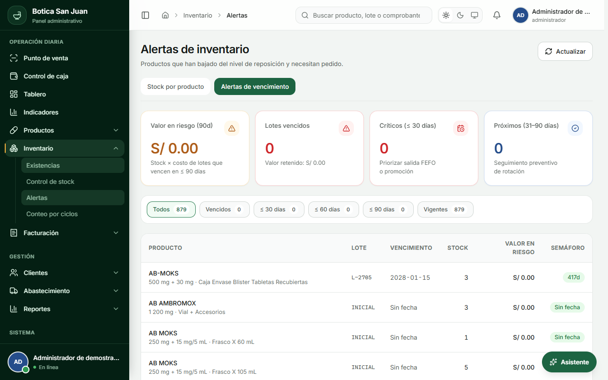 |
| `EF-04` | Recuperación de contraseña | 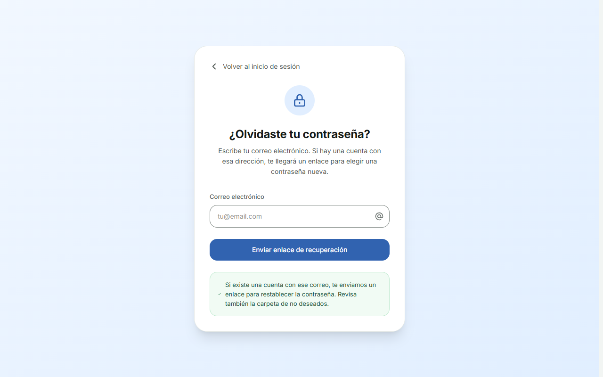 |
| `EF-05` | Registro de usuario y flujo de acceso | 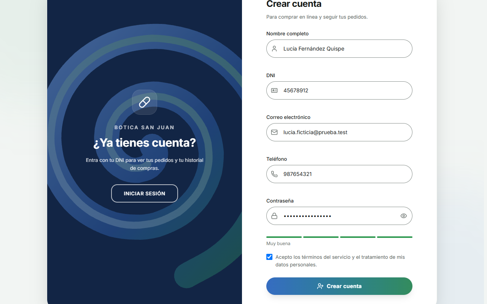 |
| `EF-06` | Pedido registrado desde el portal cliente | 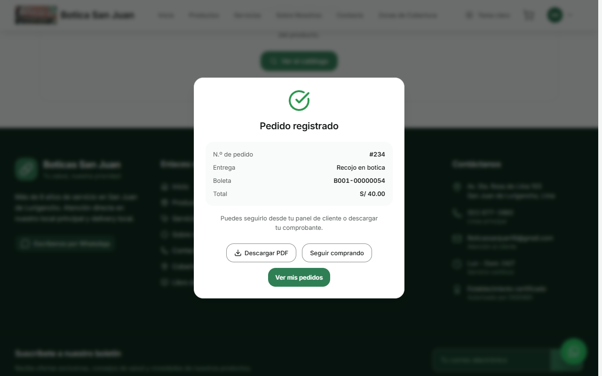 |
| `EF-07` | Catálogo público de productos | 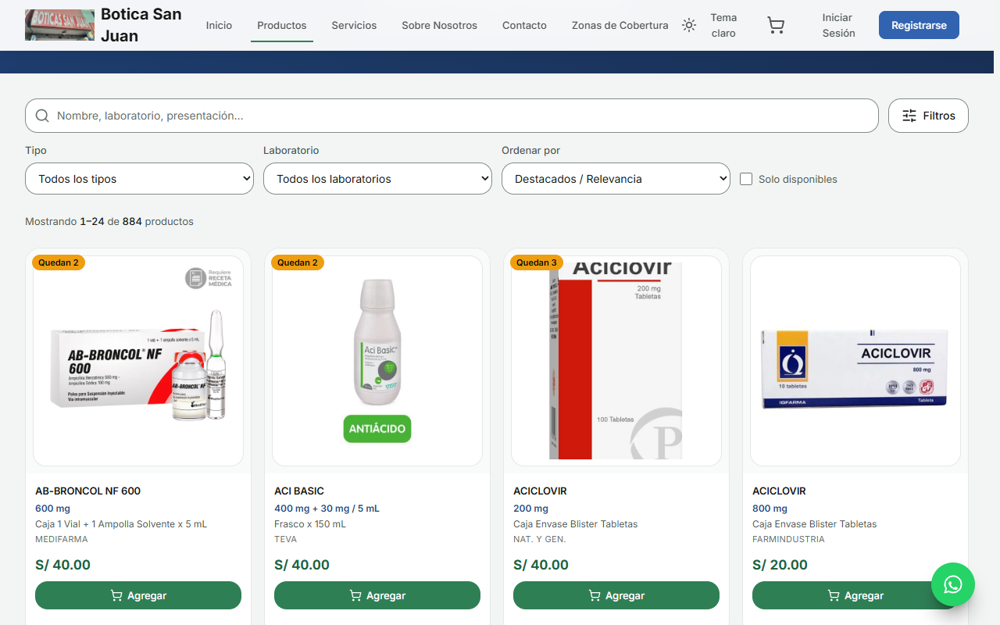 |
| `EF-08` | Checkout del portal cliente | 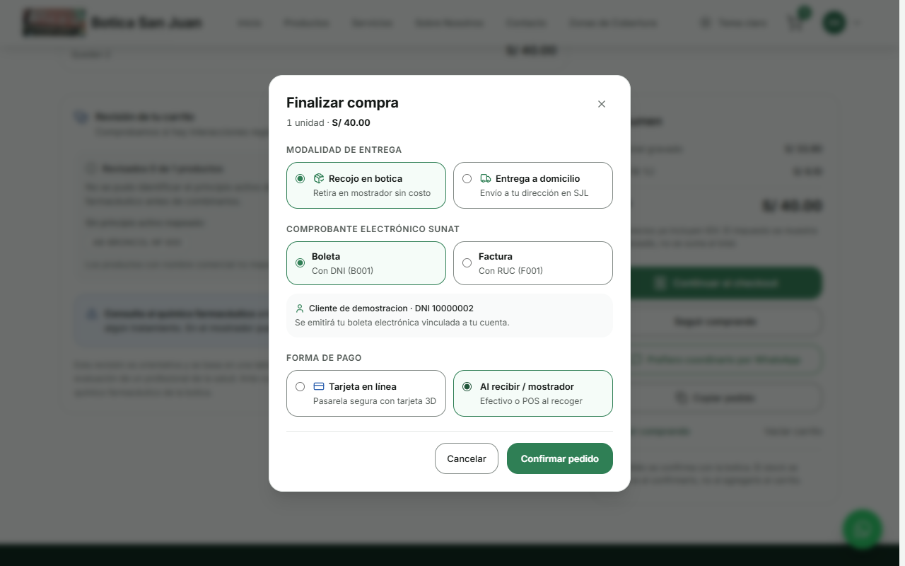 |
| `EF-09` | Punto de venta (POS) | 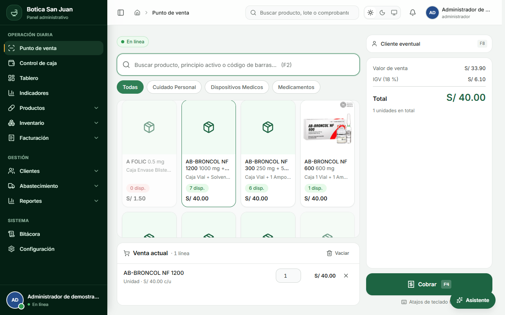 |
| `EF-10` | Asistente importador de Excel/CSV | 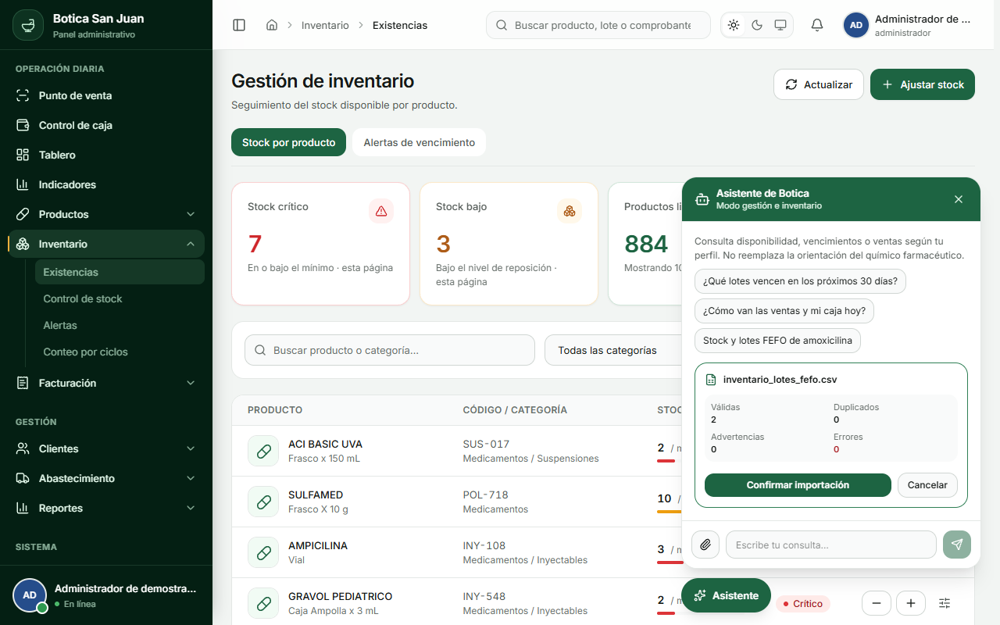 |
| `EF-11` | Documentación OpenAPI 0.8.0 | 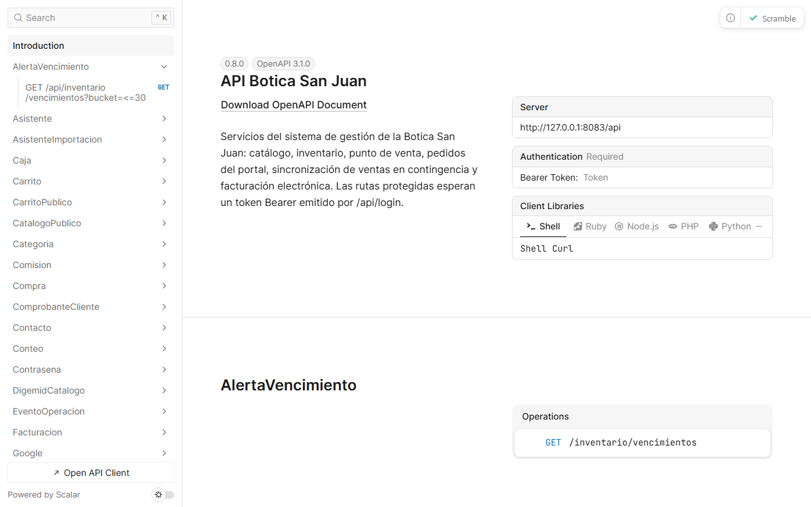 |

---

## 34. Conclusiones y recomendaciones

### 34.1. Conclusiones basadas en evidencia del proyecto

1. **Un servicio que responde `200` no equivale a un servicio sano (C1):** En INC-01, `/api/salud` respondió `200` sirviendo código de cuatro días antes porque `config:cache` fallaba al arrancar el nuevo contenedor. Una nota en comentario del `Dockerfile` no previno la recaída; lo que la cerró fue una prueba automatizada que ejecuta `config:cache` (`DepuracionSentryTest::test_la_configuracion_se_puede_cachear`).
2. **El esquema de base de datos es un control de negocio efectivo (C2):** Las llaves foráneas `RESTRICT` impidieron borrar productos con ventas durante el simulacro de PostgreSQL. Asimismo, un simulacro que no introduce daño real (como la versión inicial sobre SQLite) tranquiliza pero no verifica.
3. **Exponer una API pública obliga a decidir qué se oculta (C3):** La fachada pública devuelve trece campos explícitos y `disponible` (booleano) en lugar de `stock`, con CORS permisivo acotado por lista de rutas. Los arreglos de enrutamiento parciales solo cambian un `500` por un `405` (INC-02).
4. **El promedio oculta las colas de latencia (C4):** Un umbral sin agregación ni ventana no es verificable. La adopción de percentiles (`p95`), segmentación por tipo de tráfico (mostrador a la mitad) y doble umbral (preventivo y crítico) alinea el monitoreo con la operación real de la botica.

### 34.2. Recomendaciones operativas

| N.º | Recomendación | Cierra / Mitiga |
|---|---|---|
| **R1** | Automatizar la verificación post-despliegue de endpoints concretos (`/api/catalogo`, `/docs/v1`, `/api/productos/destacados`) además de `/api/salud` (indicador M6). | Detección tardía de despliegues fallidos (INC-01) |
| **R2** | Programar la ejecución diaria de `infra/backup/` y registrar su código de salida (indicador M9). | Cobertura efectiva del RPO de 24 h (RNF08) |
| **R3** | Migrar los archivos subidos (`storage/app`) a almacenamiento de objetos (S3 o R2) y evaluar plan de pago en Render si se requiere cumplir RNF05 (≥ 99 %). | Pérdida por disco efímero y arranque en frío (~50 s) |
| **R4** | Verificar un dominio propio en Resend (registros SPF/DKIM) y cambiar `MAIL_FROM_ADDRESS` antes de habilitar correos transaccionales a clientes reales. | Limitación de entrega exclusiva al titular en Resend |
| **R5** | Incorporar Pint/PHPStan y ESLint al pipeline CI, ejecutar prueba de carga p95 sobre búsqueda (RNF03) y activar MFA en la cuenta administrativa de producción (RF01). | Brechas parciales en RNF07, RNF03 y RF01 |
